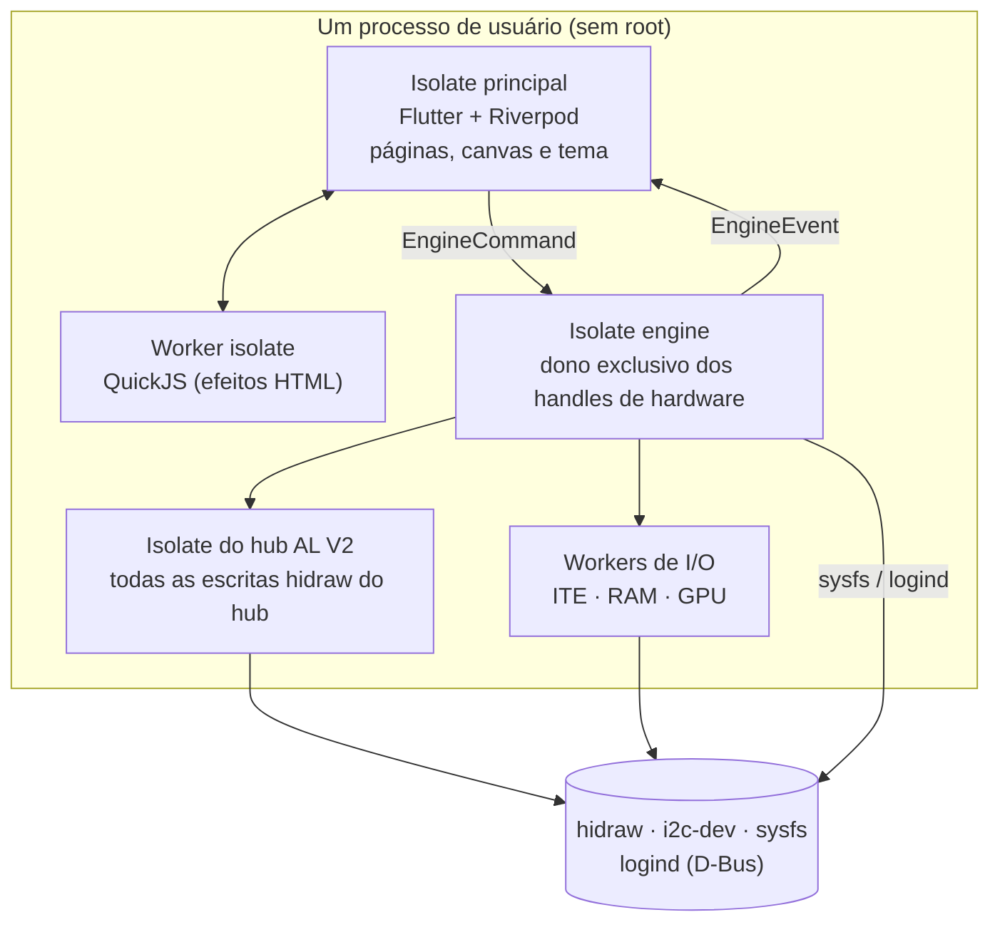
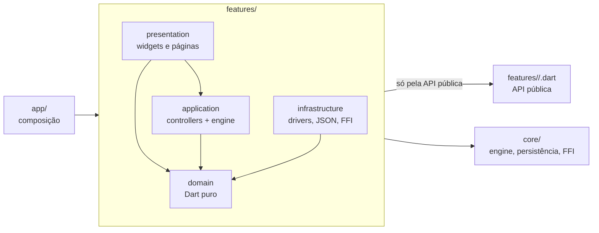
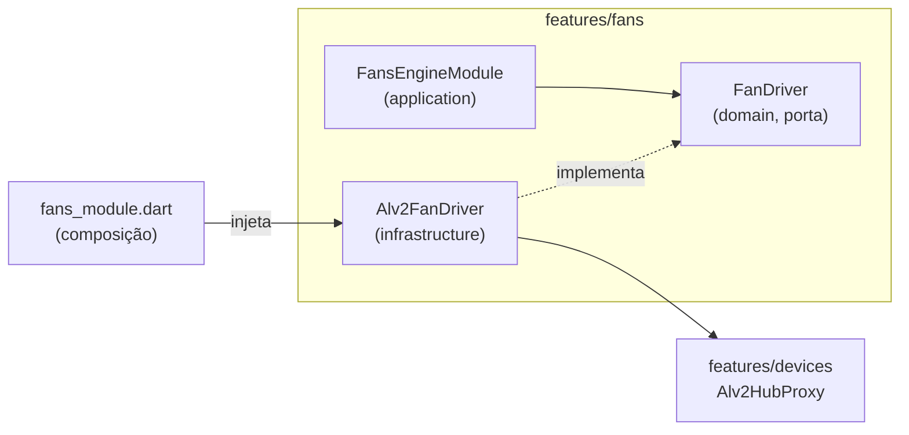
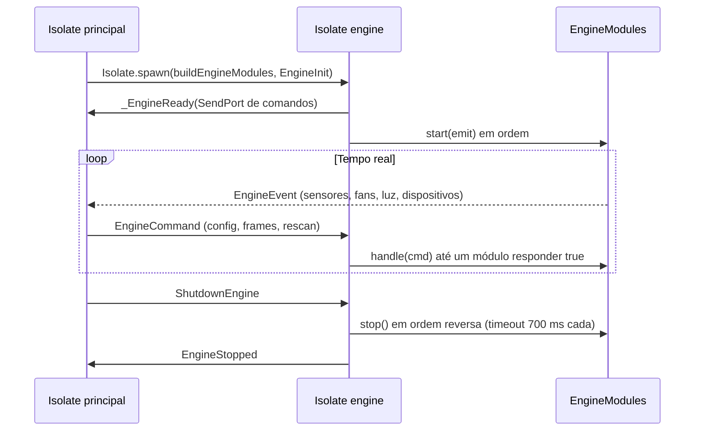
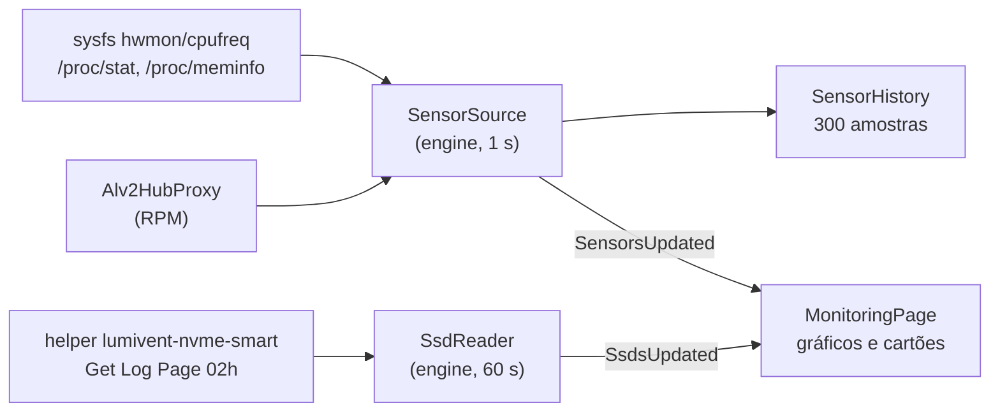
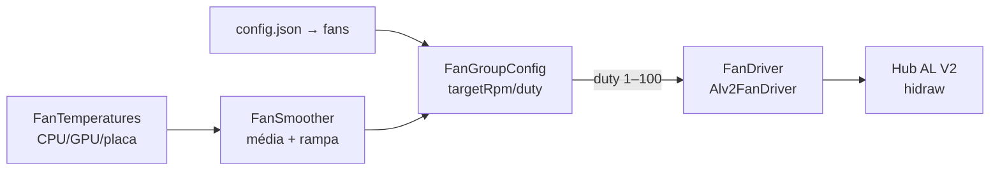
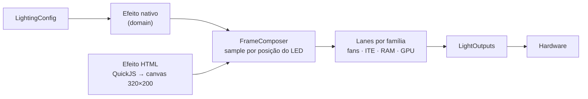

# Arquitetura do Lumivent

Decidida em 2026-10-18, na fase 1. As regras de import abaixo são verificadas
por `test/architecture_test.dart`: quebrar uma delas faz `flutter test` falhar.

## Decisão

**Monólito modular, feature-first, com camadas DDD dentro de cada módulo.**

- **Um processo só** (UI + isolate da engine), mas o código é dividido em
  **módulos** por área do negócio (`lib/features/<módulo>/`), não por tipo
  técnico (`widgets/`, `services/`…).
- Cada módulo é um **bounded context**: tem o próprio domínio, os próprios
  comandos e eventos da engine e a **própria seção** no `config.json`. Como um
  banco por módulo, só que num arquivo.
- Os módulos conversam **só pela API pública** (`features/<m>/<m>.dart`). O
  resto é interno.

## Visão geral dos processos e isolates



Por que tantos isolates:

- **engine**: concentra os laços de tempo real (fans, LEDs, sensores) e é o
  único dono dos handles. A UI pode fechar ou trocar de página sem interromper
  a iluminação.
- **hub AL V2**: toda escrita hidraw bloqueia a thread; um worker dedicado
  evita que o frame de LED atrase a leitura de RPM ou o duty das fans. O handle
  é compartilhado por monitoring, fans e lighting.
- **workers de I/O**: ITE, SMBus (RAM) e I²C da GPU também bloqueiam. Cada
  família tem a própria lane para que uma escrita lenta não atrase as outras.
- **QuickJS**: o script de um efeito HTML pode entrar em laço infinito.
  Ele roda em worker isolado, com limite rígido, e a UI apenas rasteriza o
  canvas e envia os pixels à engine.

## Estrutura

```
lib/
  main.dart                 # chama app/bootstrap.dart
  app/                      # composição: junta os módulos (só ela conhece todos)
    bootstrap.dart          # raiz de composição: config, engine, overrides, janela
    engine_modules.dart     # quais EngineModule rodam no isolate da engine
    app.dart · navigation/ · shell/ (sidebar, topbar, página de Configurações)
    desktop/                # janela + bandeja (window_manager, tray_manager)
    config_transfer.dart    # exportar/importar o config.json
  core/                     # shared kernel técnico, sem regra de negócio
    engine/engine_host.dart # isolate, EngineModule, EngineCommand/EngineEvent
    persistence/config_store.dart  # config.json em seções por módulo
    platform/               # FFI: hidapi, SMBus (ioctl), acesso a /dev
    ui/                     # tema e widgets genéricos
  features/<módulo>/
    <módulo>.dart           # API pública (barrel): única porta de entrada
    <módulo>_module.dart    # composição do módulo: liga portas → implementações
    domain/                 # entidades, value objects, portas (interfaces). Dart puro
    application/            # casos de uso: controllers Riverpod, EngineModule, mensagens
    infrastructure/         # implementações das portas: drivers, FFI, JSON, systemd
    presentation/           # widgets e páginas
```

Módulos atuais:

| Módulo | Responsabilidade | Seção da config | Na engine |
|---|---|---|---|
| `devices` | detecção, identificação e drivers do hardware: `Alv2Hub` (RPM, duty, luz), `IteController` (zonas e D_LED1), `FuryController` (SMBus com guardas), `GpuController` (I²C OEM do amdgpu em `0x75`, com guardas de SSID/comandos) | — | `DevicesEngineModule` |
| `lighting` | config de luz por dispositivo (canvas, hardware, cor fixa), efeitos nativos, canvas 320×200, Desligar ARGB, apagar ao suspender (logind); runtime de efeitos HTML | `lighting` | `LightingEngineModule` |
| `preferences` | bandeja ao fechar, °C/°F, FPS | `preferences` | — |
| `system` | início automático (systemd --user) e diagnóstico do ambiente | — | — |
| `monitoring` | sensores (hwmon, cpufreq, `/proc`, RPM do AL V2 pelo `Alv2Hub` do `devices`) com 5 min de histórico; SMART dos NVMe pelo helper | — | `MonitoringEngineModule` |
| `fans` | curvas e presets das fans AL V2, laço de 1 s; o protocolo fica no `devices` (`Alv2Hub`) | `fans` | `FansEngineModule` |
| `explore` | biblioteca local de efeitos HTML importados: busca, filtros e importação | — | — |

## Regras de dependência

1. `core/` não conhece `app/` nem `features/`.
2. `features/` não conhecem `app/`.
3. Um módulo importa outro **só** por `features/<outro>/<outro>.dart`.
4. `domain/` é Dart puro: sem Flutter, Riverpod, `dart:io`, `dart:ffi`,
   `dart:ui` e isolates. Depende só do próprio `domain/`.
5. `application/` não depende de `infrastructure/` nem de `presentation/`. Ela
   declara providers das portas (`throw UnimplementedError`), e o
   `<módulo>_module.dart` faz os overrides com as implementações.
6. `presentation/` não depende de `infrastructure/`.



A regra 3 é a que mantém o monólito modular: nenhum `import` direto de
`domain/`, `application/` ou `infrastructure/` de outro módulo. O barrel
`<módulo>.dart` reexporta somente o que é contrato.

## API pública dos módulos

| Módulo | Barrell | Contrato principal |
|---|---|---|
| `devices` | `devices.dart` | `DeviceDetector`, `DeviceInfo`/`DeviceSnapshot`, `Alv2HubProxy`, `IteController`, `FuryController`, `GpuController`, guardas de protocolo |
| `monitoring` | `monitoring.dart` | `SensorSource`, `Metrics`, `SensorSample`/`SensorHistory`, `SsdReader`, `NvmeSmartLog`, `SsdInfo` |
| `fans` | `fans.dart` | `FanDriver`, `FanTemperatures`, `FansRepository`, `FanGroupConfig`/`FansConfig`, `FanPreset`, `FanResponse`, `FansEngineModule` |
| `lighting` | `lighting.dart` | `LightOutputs`, `LightingConfig`, `LightDeviceId`/`LightMode`, `nativeEffectById`, `EffectLibrary`, `EffectImporter`, `EffectRuntime`, `LightingEngineModule` |
| `preferences` | `preferences.dart` | `Preferences`, `TemperatureUnit`, `PreferencesRepository`, `PreferencesCard` |
| `system` | `system.dart` | `AutostartService`, `EnvironmentDiagnostics`, `DiagnosticCheck`, cards de Configurações |
| `explore` | `explore.dart` | `ExplorePage` |

O `domain/` declara as **portas** (interfaces); a composição do módulo escolhe
as implementações:



Isso permite testar `FansEngineModule` com um `FanDriver` fake, sem hardware.

## Engine

`core/engine` não sabe nada das features. Cada módulo que precisa de tempo real
fornece:

- um `EngineModule` (`start(emit)`, `handle(command) → bool`, `stop()`), montado
  **dentro** do isolate por `app/engine_modules.dart` (handles FFI não atravessam
  isolates);
- os próprios `EngineCommand`/`EngineEvent` em
  `application/<módulo>_messages.dart`.

A UI lê os eventos pelo `engineProvider` (`events`, `lastEvent<T>()`) e manda
comandos com `send`.

### Ciclo de vida



Ordem dos módulos em `buildEngineModules`:

```text
[devices, monitoring, fans, lighting]
```

A engine para em ordem reversa. A iluminação para primeiro (nenhum frame depois
que o hub fechar), depois as fans enviam o duty de saída, e só então o
monitoring libera o `Alv2HubProxy`. Um módulo que não responde em 700 ms não
bloqueia a saída; após 3 s a UI mata o isolate.

### Comandos e eventos

| Módulo | Comandos | Eventos |
|---|---|---|
| `devices` | `RescanDevices` | `DevicesChanged` |
| `monitoring` | `RequestSensorHistory` | `SensorsUpdated`, `SensorHistoryReplay`, `SsdsUpdated` |
| `fans` | `SetFansConfig` | `FansStatus` |
| `lighting` | `SetArgbOff`, `SetLightingConfig`, `SetHtmlEffectFrame`, `IdentifyFanGroup`, `SetLightingFps` | `ArgbStateChanged`, `LightingStatus` |

Regras de robustez:

- Um módulo que lança exceção ao tratar um comando **continua sendo o dono** do
  comando; os seguintes não são tentados.
- Comando sem dono é registrado em `stderr` e descartado.
- Erro de um sensor não impede os outros: `MonitoringEngineModule` isola cada
  `SensorSource`.
- A engine nunca abre um dispositivo sem permissão; o driver devolve `false` e
  a UI mostra o motivo.

## Fluxos de dados

### Monitoramento



- Amostras a cada 1 s; histórico de 300 leituras (5 min).
- SMART a cada 60 s; se algum SSD não tiver dados, tenta de novo a cada 10 s
  (o helper pode aparecer sem reiniciar o app).
- A temperatura lida aqui é a mesma usada pelas curvas de fan: `fans` recebe
  `() => monitoring.latest` dentro da engine.

### Fans



- Laço de 1 s; ciclos nunca se sobrepõem.
- Mudanças de configuração são agrupadas por 100 ms (o editor envia um comando
  por movimento do mouse).
- Resposta `normal`: média de 4 s, sobe 15 pontos/s e desce 3; `smooth`: média
  de 10 s, sobe 5 e desce 1; `fast`: sem média nem rampa.
- Sem leitura de temperatura, o grupo não é atualizado.
- Na saída, cada grupo recebe o duty da própria curva na última temperatura
  (sem start/stop), para a fan não ficar parada sem o app.

### Iluminação e efeitos



- Canvas lógico de 320×200; cada dispositivo ocupa um retângulo e cada LED tem
  uma posição normalizada.
- O laço roda na FPS da preferência (15/30/60; padrão 30). Só o que mudou é
  enviado, com reenvio de segurança a cada 5 s.
- Cada família tem uma lane com no máximo um frame em voo. As fans usam
  `alv2SafeStreamGap` (500 ms, ~2 fps) para o RPM não cair; ITE, RAM e GPU usam
  33/66/120 ms.
- A engine mede a latência de envio de cada família (EMA) e compõe o frame para
  `t + latência`, alinhando a fase entre fans, fita, RAM e GPU.
- Quando o efeito tem equivalente no firmware, `hardware_equivalents.dart`
  escolhe o modo e entrega o dispositivo ao firmware (mais suave que o
  streaming).
- “Desligar todos os ARGB” e suspender/desligar aplicam a sequência de off em
  todos os drivers e param o laço; religar refaz o init e reenvia os modos.
- Ao sair, a iluminação **não** apaga: os LEDs ficam como estavam.

### Dispositivos

- `DevicesEngineModule` faz uma varredura inicial e consulta a presença a cada
  5 s (hidraw enumerado, barramentos I²C e programas conflitantes).
- A varredura completa só roda quando a chave de presença muda ou quando a UI
  pede `RescanDevices`.
- Programas concorrentes (OpenRGB, liquidctl, CoolerControl, ckb-next) são
  detectados por `/proc` e apenas **avisados**; o app nunca mata processos.

## Persistência

Um único `config.json`, com uma seção por módulo e `version` de schema:

```json
{
  "version": 1,
  "preferences": { "closeToTray": true, "temperatureUnit": "celsius", "effectsFps": 30 },
  "fans": { "groups": [] },
  "lighting": { "effectId": "rainbowWave" }
}
```

- Escrita atômica (arquivo temporário + `rename`) e serializada por uma fila.
- Cada módulo lê e grava apenas a própria seção.
- Leitura tolerante: chave ausente, tipo errado ou valor desconhecido cai no
  default; um `config.json` antigo continua abrindo.
- Arquivo corrompido é renomeado para `config.json.bad` em vez de ser
  sobrescrito silenciosamente.
- Importação substitui apenas as seções conhecidas, em uma escrita, após copiar
  o arquivo atual para `config.json.antes-import`.

O formato completo está em [`configuracao.md`](configuracao.md).

## Como adicionar um módulo

O `fans` (fase 3) é o exemplo mais completo:

1. `domain/`: `fan_curve.dart` (`FanPreset`, `toRpmPhases`, `calculateSpeed`,
   `dutyFor`) e `fan_group.dart` (`FanGroupConfig`, `FansConfig` e as portas
   `FanDriver`, `FanTemperatures`, `FansRepository`).
2. `application/`: `FansEngineModule` (laço de 1 s), `fans_messages.dart` e os
   controllers Riverpod.
3. `infrastructure/`: repositório JSON na seção `fans`. O protocolo do AL V2
   continua no `devices`, que expõe uma porta de controle de fans pela API
   pública.
4. `presentation/`: página e editor de curva.
5. Exportar o necessário em `fans.dart`, criar `fans_module.dart` e registrar o
   módulo em `app/engine_modules.dart` e `app/bootstrap.dart`.

Quando dois módulos da engine precisam do mesmo handle (ex.: o `Alv2Hub`, usado
por monitoring, fans e lighting), ele é aberto uma vez em
`app/engine_modules.dart` e passado a todos. Só um deles o libera (o
monitoring), e a ordem da lista define quem para primeiro.

## Idioma

Desde 2026-10-19: código, comentários e nomes de testes em **inglês**; textos da
interface em **português** (o `find.text` dos testes de widget usa o texto em
português). Os documentos em `docs/` continuam em português.
